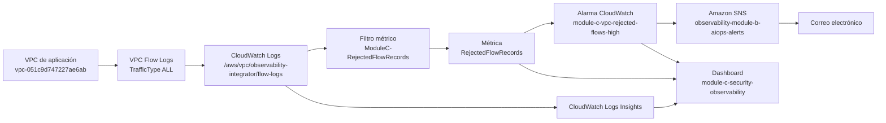

# Módulo C — Observabilidad de red y seguridad en AWS

## 1. Objetivo

Este módulo incorpora una primera capa de observabilidad de seguridad sobre la infraestructura AWS del proyecto `observability-integrator`. El alcance implementado se centra en la visibilidad del tráfico de red mediante VPC Flow Logs, la generación de una métrica de registros rechazados, una alarma en CloudWatch y su notificación por correo electrónico mediante Amazon SNS.

La implementación se realizó en la región `us-east-2` (US East, Ohio), sin modificar los servicios ECS, la base de datos RDS ni las reglas de los grupos de seguridad existentes.

## 2. Alcance y límites

### Implementado y validado

- VPC Flow Logs para registrar tráfico `ALL` de la VPC.
- Entrega de registros a CloudWatch Logs.
- Filtro métrico para contabilizar registros cuya acción es `REJECT`.
- Alarma de CloudWatch sobre la métrica.
- Acción SNS asociada a la alarma y recepción del correo de notificación.
- Dashboard de CloudWatch con serie temporal, estado de la alarma y consulta de registros `REJECT`.
- Consultas de CloudWatch Logs Insights para investigar registros rechazados.

### Pendiente o restringido

- **Amazon Inspector:** las consultas de estado y cobertura fueron bloqueadas por una política de control de servicios (SCP) de AWS Organizations. El escaneo básico de una imagen ECR también devolvió `UnsupportedImageError`. No se dispone de un inventario validado de CVE para esas imágenes.
- **AWS Security Hub:** la consulta de estado fue bloqueada por una SCP. No se considera habilitado ni implementado en esta cuenta.
- **Fallos de autenticación:** la consulta inicial en el grupo de logs de la aplicación no devolvió coincidencias con los términos usados (`401`, `403`, `Unauthorized`, `authentication`, `login failed`). Esto no demuestra que no existan fallos; significa que no se encontró una fuente de eventos de autenticación verificable con esa consulta.
- **Mitigación automática o bloqueo de IP:** no se implementó. Los registros `REJECT` no constituyen, por sí solos, evidencia de ataque.
- **AWS Config:** no se habilitó un recorder para evitar activar componentes con posibles costos sin autorización previa.

## 3. Recursos implementados

| Recurso | Identificador o configuración | Resultado |
|---|---|---|
| Región AWS | `us-east-2` | Validada |
| VPC | `vpc-051c9d747227ae6ab` | VPC observada |
| VPC Flow Log | `fl-0e0e19a230315a65d` | `ACTIVE`; entrega `SUCCESS` |
| Tipo de tráfico | `ALL` | Aceptados y rechazados |
| Grupo de logs | `/aws/vpc/observability-integrator/flow-logs` | Registros recibidos; retención de 3 días |
| Rol de entrega | `observability-integrator-vpc-flow-logs-role` | Configurado para entregar logs |
| Filtro métrico | `ModuleC-RejectedFlowRecords` | Creado |
| Namespace | `ObservabilityIntegrator/Security` | Configurado |
| Métrica | `RejectedFlowRecords` | Cuenta registros `REJECT` |
| Alarma | `module-c-vpc-rejected-flows-high` | Creada; observada en estado `ALARM` durante la validación |
| Umbral | `>= 50` en un periodo de 300 segundos | Umbral inicial operativo |
| Acción de alarma | `arn:aws:sns:us-east-2:467866783326:observability-module-b-aiops-alerts` | Acción ejecutada; correo recibido |
| Dashboard | `module-c-security-observability` | Creado y validado por API de CloudWatch |

La alarma usa la estadística `Sum`, un periodo de 300 segundos, un punto de datos para dispararse y `notBreaching` para tratar los datos ausentes como no infractores.

## 4. Flujo de telemetría



## 5. Configuración y comportamiento

### 5.1 VPC Flow Logs

El Flow Log registra el tráfico de la VPC y entrega los eventos al grupo `/aws/vpc/observability-integrator/flow-logs`. Durante la validación, el estado fue `ACTIVE` y el estado de entrega `SUCCESS`. Se observaron registros con acciones `ACCEPT` y `REJECT`.

Los registros de flujo son agregaciones de tráfico de red. Un registro no equivale necesariamente a una conexión única, una petición de aplicación ni un incidente de seguridad.

### 5.2 Filtro métrico

El filtro `ModuleC-RejectedFlowRecords` usa el formato estándar de VPC Flow Logs y selecciona los registros cuyo campo `action` es `REJECT`. Cada registro coincidente incrementa la métrica `RejectedFlowRecords` en uno, dentro del namespace `ObservabilityIntegrator/Security`.

El filtro empieza a generar puntos de métrica desde su creación; no reconstruye retroactivamente el histórico anterior. Por ello, las consultas de Logs Insights sobre una hora y los valores de la métrica pueden diferir.

### 5.3 Alarma y notificación

La alarma `module-c-vpc-rejected-flows-high` se configuró para entrar en estado `ALARM` cuando la suma de la métrica sea mayor o igual a 50 en un periodo de cinco minutos. Durante la validación, CloudWatch evaluó un punto de datos de `112`, por encima del umbral, y la alarma pasó de `INSUFFICIENT_DATA` a `ALARM`.

El historial de CloudWatch registró la ejecución correcta de la acción SNS el 18 de octubre de 2026 a las 22:29:38 UTC. También se verificó la recepción del correo con el asunto que identifica la alarma.

**Interpretación:** esta alerta indica que se superó el umbral de registros rechazados; no confirma por sí misma un ataque. El umbral de 50 es un valor inicial y debe revisarse con una línea base más extensa y con el patrón normal de tráfico de la VPC.

### 5.4 Dashboard

El dashboard `module-c-security-observability` se creó en CloudWatch. Incluye:

1. Texto explicativo del alcance y de las limitaciones de los servicios de seguridad.
2. Serie temporal de `RejectedFlowRecords`.
3. Estado de la alarma `module-c-vpc-rejected-flows-high`.
4. Consulta de Logs Insights para consultar registros `REJECT` recientes.

El dashboard no muestra métricas de autenticación ni CVE porque no se dispone de fuentes verificadas para esos indicadores.

## 6. Hallazgos durante la validación

Las consultas de Logs Insights encontraron registros rechazados con distintos orígenes, destinos e interfaces. Entre los ejemplos observados se incluyeron tráfico hacia direcciones privadas de la VPC por los puertos TCP 23 y 3002, entre otros. Estos ejemplos se registran como observaciones para investigar, no como atribución de actividad maliciosa.

En una consulta de la última hora se reportaron 1.385 registros coincidentes y 3.146 registros examinados. En otra consulta temporal se observaron intervalos de cinco minutos con 125, 217 y 224 registros rechazados. Los resultados dependen de la ventana de tiempo consultada y del momento de ingesta; no deben tratarse como una línea base permanente.

No se modificaron las reglas de grupos de seguridad ni se bloquearon IP. La investigación se mantuvo en modo observacional.

## 7. Restricciones y riesgos conocidos

### Amazon Inspector y ECR

Las operaciones `inspector2:BatchGetAccountStatus` y `inspector2:ListCoverage` fueron denegadas por una SCP de AWS Organizations. El escaneo básico de una imagen ECR también falló con `UnsupportedImageError: The image is not supported`. En consecuencia, no se deben presentar las imágenes como libres de vulnerabilidades ni informar cantidades de CVE a partir de estas pruebas.

**Acción requerida:** solicitar al administrador de AWS Organizations que revise la política y autorice el acceso apropiado a Inspector, si la organización lo permite. Cualquier habilitación de escaneo avanzado debe evaluarse por alcance y costo antes de ejecutarse.

### AWS Security Hub

La consulta de Security Hub fue bloqueada por una SCP. La activación debe ser revisada por el administrador de la organización. No se intentó eludir la política.

### Autenticación

La consulta inicial sobre el grupo `/ecs/observability-integrator` no encontró coincidencias con los términos de autenticación consultados. Se requiere identificar el mecanismo de autenticación de la aplicación y su formato de logs antes de crear una métrica o alarma fiable para fallos de inicio de sesión.

### Retención de logs

El grupo de Flow Logs y los grupos ECS observados tienen una retención de tres días. El grupo `/aws/lambda/module-b-alert-enrichment` no tenía retención definida en la comprobación realizada. La retención debe revisarse según los requisitos de auditoría, privacidad y presupuesto.

## 8. Operación y diagnóstico

### Consultar el estado del Flow Log

```bash
aws ec2 describe-flow-logs \
  --region us-east-2 \
  --flow-log-ids fl-0e0e19a230315a65d \
  --query 'FlowLogs[].{Id:FlowLogId,Status:FlowLogStatus,Delivery:DeliverLogsStatus,Group:LogGroupName,Traffic:TrafficType}' \
  --output table
```

### Consultar el estado de la alarma

```bash
aws cloudwatch describe-alarms \
  --region us-east-2 \
  --alarm-names module-c-vpc-rejected-flows-high \
  --query 'MetricAlarms[].{Name:AlarmName,State:StateValue,Reason:StateReason,Threshold:Threshold,Period:Period,Actions:AlarmActions}' \
  --output json
```

### Consultar los filtros métricos

```bash
aws logs describe-metric-filters \
  --region us-east-2 \
  --log-group-name /aws/vpc/observability-integrator/flow-logs \
  --query "metricFilters[?filterName=='ModuleC-RejectedFlowRecords']" \
  --output json
```

### Consultar el dashboard

```bash
aws cloudwatch get-dashboard \
  --region us-east-2 \
  --dashboard-name module-c-security-observability \
  --query '{Name:DashboardName,Arn:DashboardArn}' \
  --output json
```

### Consultar registros rechazados con Logs Insights

Desde CloudWatch → Logs Insights, seleccionar `/aws/vpc/observability-integrator/flow-logs` y ejecutar una consulta equivalente a:

```text
parse @message "* * * * * * * * * * * * * *" as version, account, eni, srcaddr, dstaddr, srcport, dstport, protocol, packets, bytes, start, end, action, status
| filter action = "REJECT"
| stats count(*) as records by eni, srcaddr, dstaddr, dstport, protocol
| sort records desc
| limit 20
```

Para investigar un pico, limitar el intervalo de tiempo y comparar interfaz, origen, destino y puerto. No bloquear una dirección IP basándose solo en una coincidencia de Flow Logs.

## 9. Evidencias del repositorio

Guardar las capturas reales en `docs/evidence/integrator/aws/module-c/`. No agregar capturas ilustrativas ni marcar como capturada una evidencia que aún no se haya guardado.

Nombres recomendados:

| Archivo | Evidencia |
|---|---|
| `vpc-flow-logs-active.png` | Flow Log con estado `ACTIVE` y entrega `SUCCESS` |
| `flow-logs-accept-reject.png` | Ejemplos de registros `ACCEPT` y `REJECT` |
| `metric-filter-rejected-flows.png` | Filtro `ModuleC-RejectedFlowRecords` |
| `cloudwatch-alarm-details.png` | Umbral, periodo y acción SNS de la alarma |
| `cloudwatch-alarm-history.png` | Historial de transición y ejecución de acción |
| `cloudwatch-sns-email-notification.png` | Correo de alerta recibido |
| `security-dashboard.png` | Dashboard `module-c-security-observability` |
| `logs-insights-rejected-flows.png` | Consulta y resultados de tráfico rechazado |
| `inspector-scp-denied.png` | Denegación de acceso de Inspector por SCP |
| `security-hub-scp-denied.png` | Denegación de Security Hub por SCP |

Los nombres son una convención recomendada. Deben coincidir con los nombres de archivo realmente incorporados al repositorio.

## 10. Criterios de aceptación

- [x] VPC Flow Logs activos y entregando registros.
- [x] Filtro métrico para registros `REJECT` creado.
- [x] Alarma de CloudWatch creada y disparada durante la validación.
- [x] Acción SNS ejecutada correctamente.
- [x] Correo de notificación recibido.
- [x] Dashboard de seguridad creado.
- [x] Consultas de Logs Insights ejecutadas para investigar los rechazos.
- [ ] Habilitar y validar Inspector, sujeto a autorización de la organización y evaluación de costos.
- [ ] Habilitar y validar Security Hub, sujeto a autorización de la organización.
- [ ] Identificar una fuente fiable de fallos de autenticación.
- [ ] Establecer una línea base de tráfico y revisar el umbral de 50 registros por cinco minutos.
- [ ] Revisar la política de retención del grupo de logs de Lambda.
